# Sun Blade 100 Workstation Restoration

Version: 1.0.0 | Date: 2026-10-31

[English](README.md) | [简体中文](README.zh-CN.md)

In September 2026, I purchased a used Sun Blade 100 workstation. This document describes how I repaired its NVRAM, upgraded the hardware, installed Solaris 9, and updated the firmware. At the end, I have listed the online resources I used for readers who would like to learn more.

I performed all operations through the Sun Blade 100's serial console.

## Original Hardware Condition

The following photos show the hardware in its original condition.

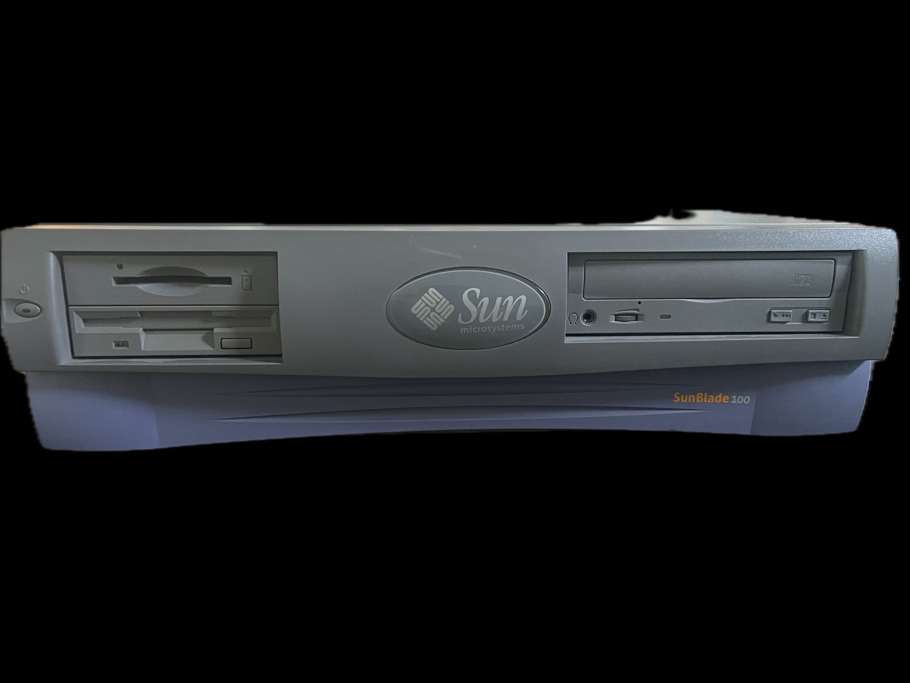

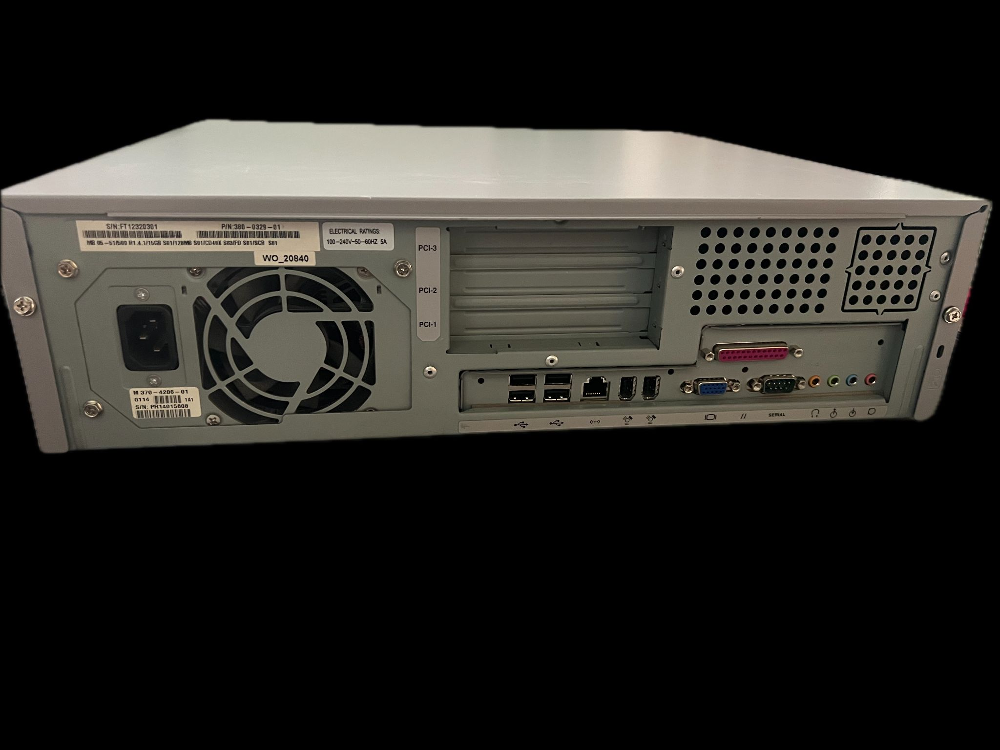

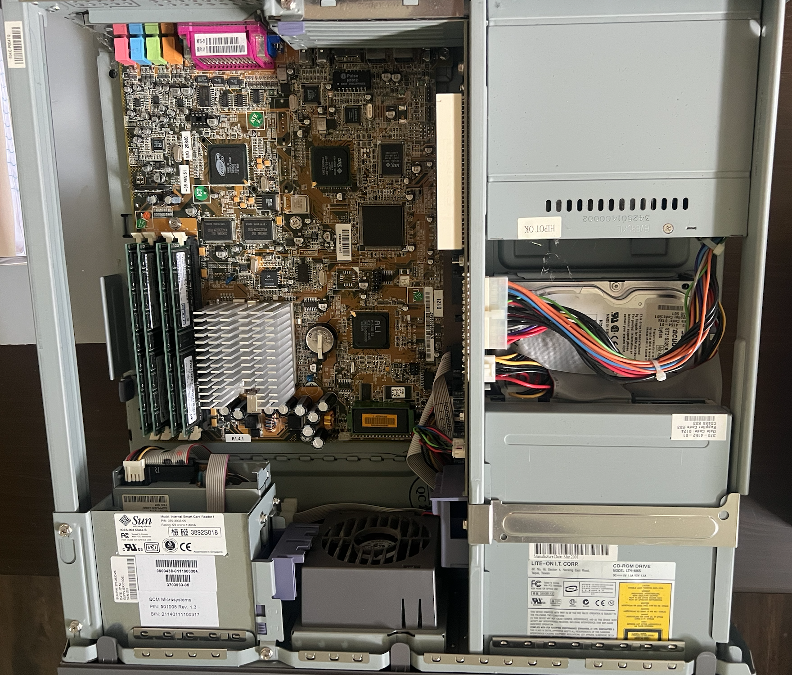

The hardware configuration before restoration is listed below.

| Component | Specification | Condition |
| --- | --- | --- |
| CPU | UltraSPARC-IIe 500MHz | Good |
| Memory | 1024 MB | Good |
| NVRAM | STMicroelectronics M48T59 | Battery depleted |
| Hard Drive | ST315320A 15.3 GB | Good |
| CD-ROM Drive | LTN486S 48X | Good |
| Firmware | OBP 4.0.45 2001/02/08 14:33<br>POST 1.2.6 2000/08/30 21:20 |  |
| Operating System | SuSE SPARC Linux version 2.4.14 |  |

## Repairing the NVRAM

The Sun Blade 100 uses NVRAM to retain hardware information such as the Ethernet MAC address and host ID, as well as the real-time clock (RTC). NVRAM was widely used across Sun systems. NVRAM failure is common in used Sun hardware, usually because the internal battery has died. Unfortunately, the battery is sealed inside the package and cannot simply be removed and replaced. When the NVRAM fails, OpenBoot displays the following error:

```text
Sun Blade 100 (UltraSPARC-IIe), No Keyboard
OpenBoot 4.0, 1024 MB memory installed, Serial #32768.
Ethernet address 0:0:0:0:0:80, Host ID: 00008000.


The IDPROM contents are invalid

Power On Self Test Failed.  Cause: NVRAM U13                          
Aborting auto-boot sequence.
ok 
```

The NVRAM must be repaired before proceeding with any other work.

Repairing the NVRAM involves two tasks: restoring battery power and recovering its data.

### Restoring Battery Power

The Sun Blade 100 uses an STMicroelectronics M48T59 NVRAM chip. Its location on the motherboard is shown below.

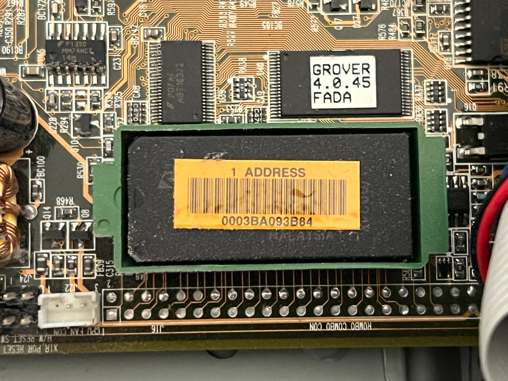

First, remove the chip from the motherboard. Be sure to pull the NVRAM straight upward: grip both sides of the green case and lift it vertically. The removed chip is shown below.

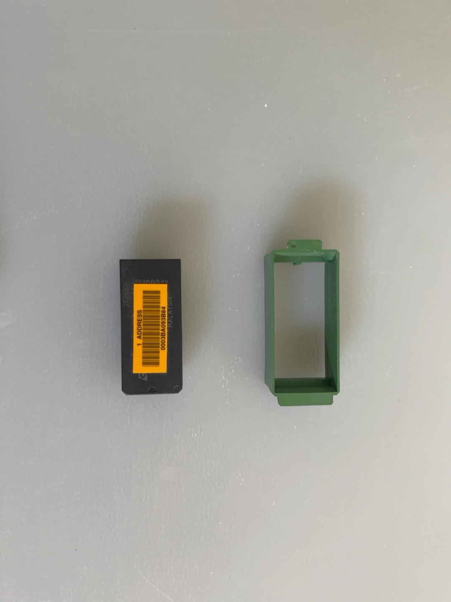

The NVRAM usually has a sticker showing the machine's Ethernet MAC address. Record this address for the NVRAM data recovery later.

Once the chip has been removed, the repair can begin. The basic approach is to physically modify the NVRAM and connect an external CR2032 coin-cell battery.

Step 1: Turn the chip over. The battery contacts are at the end opposite pin 1, between pins 14 and 15. Viewed from underneath, the chip has a small recess filled with potting compound at each end. The battery terminals are hidden in one of these recesses. Using a small knife, first cut away part of the plastic casing on the battery side, then carefully scrape away the potting compound until the battery terminals are exposed. Take care not to damage the internal structure. Stop once both battery terminals are visible. The following photo shows the NVRAM after I opened it.

Step 2: Use a multimeter to identify the positive and negative battery terminals. My measurement is shown below: the original NVRAM battery had only 0.494 V remaining. This also confirmed the terminal polarity.

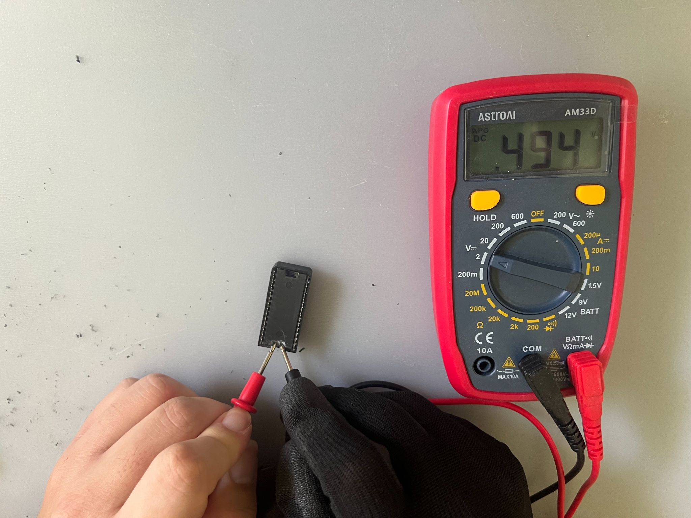

Step 3: Connect a CR2032 coin-cell battery to the exposed terminals. I soldered the [battery holder](https://www.amazon.com/dp/B0B7MFV6D1) shown below to the NVRAM. Once soldering is complete, the NVRAM is ready to use. Keep the solder joints and battery-holder wires from touching each other, as this would cause a short circuit. The following photos show my completed soldering work.

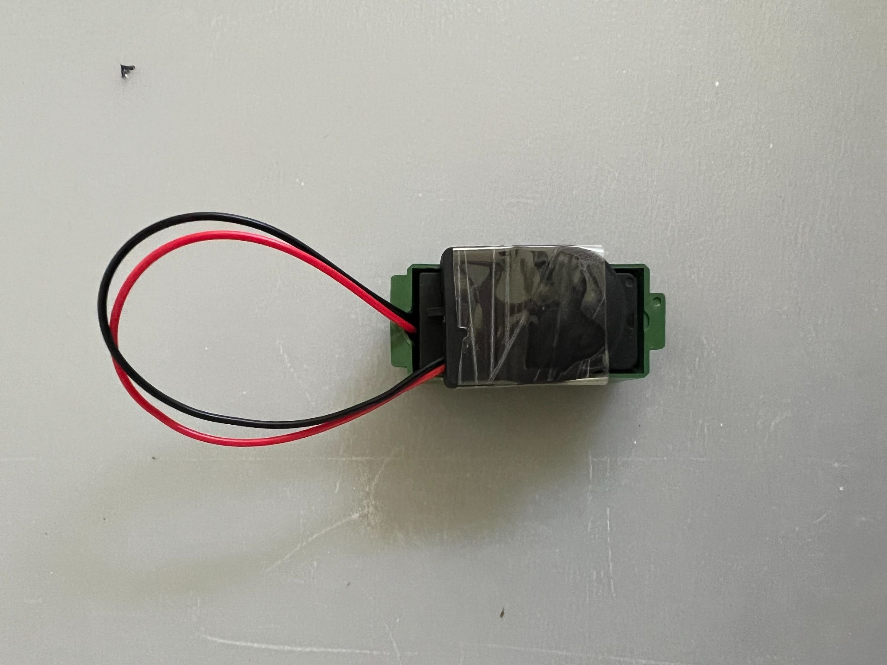

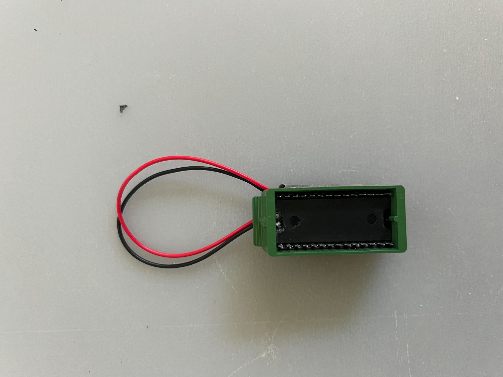

Step 4: Reinsert the repaired NVRAM into the motherboard. The following photo shows it back in place.

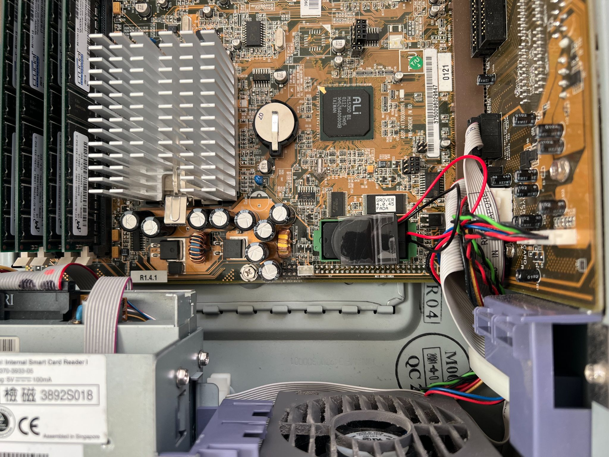

### Restoring the IDPROM Data

With a new battery connected and the NVRAM reinstalled, the IDPROM data can be restored. The first items to recover are the Ethernet MAC address and host ID. I had obtained the original Ethernet MAC address from my NVRAM, but I did not have the machine's original host ID. A common approach is to derive a usable host ID from the MAC address. This may not reproduce the original host ID; my goal was simply to generate a reasonable value that would make the IDPROM work.

The following table shows the IDPROM data format I needed to reconstruct.

Step 1: Determine the address at which to write the IDPROM. At the OpenBoot prompt, run the following commands:

```text
ok cd /pci@1f,0/ebus@c/eeprom@1,0
ok .properties
model                    mk48t59
address                  fff58000 
reg                      00000001 00000000 00002000 
device_type              nvram
name                     eeprom
```

Here, FFF58000 is the mapped base address of the NVRAM. The IDPROM is usually located at offset 0x1FD8 within the NVRAM. The address is calculated as follows:

```text
NVRAM base:     0xFFF58000
IDPROM offset:  0x00001FD8
--------------------------
IDPROM address: 0xFFF59FD8
```

The address 0xFFF59FD8 is where I needed to begin writing.

Step 2: Save the current IDPROM data. Because this NVRAM had failed, its contents were already corrupted. Reading the data lets me check whether any useful information remains; it is fine if none does. Run the following commands to read the IDPROM fields. The value 10 in the command is hexadecimal for 16, so this reads 16 bytes.

```text
ok hex
ok fff59fd8 10 dump
           0  1  2  3  4  5  6  7  \/  9  a  b  c  d  e  f  01234567v9abcdef
fff59fd0  04 88 94 08 08 08 40 00  6a 10 80 00 02 08 00 ac  ......@.j......,
fff59fe0  00 80 20 00 12 a2 14 20  08 80 00 00 04 20 00 8a  .. ..". ..... ..
```

The meanings of these bytes are listed below.

| Field | Current Data | Assessment |
| --- | --- | --- |
| Format | 6A | Incorrect; should be 01 |
| Machine Type | 10 | Unexpected value |
| MAC | 80:00:02:08:00:AC | Does not match the factory MAC address |
| Manufacturing Date | 00 80 20 00 | Cannot be confirmed |
| Serial | 12 A2 14 | Unreliable |
| Checksum | 20 | Invalid IDPROM |

The following command lets me confirm that the IDPROM data matches the values above:

```text
ok .idprom
Format/Type: 6a 10 Ethernet: 80 0 2 8 0 ac Date: 0 80 20 0 
Serial: 12 a2 14 Checksum: 20
```

Step 3: Reconstruct the IDPROM contents. Using the MAC address, I took its final three bytes as the basis for the new host ID. The reconstructed IDPROM data is shown below. Since I could not obtain the original manufacturing date, I used 00000000 for the date field; this field had no effect on practical use.

| Field | New Value | Description |
| --- | --- | --- |
| Format | 01 | Standard IDPROM format |
| Machine Type | 83 | Machine type value for the Sun Blade 100 |
| MAC | 00:03:BA:09:3B:84 | Confirmed factory address |
| Manufacturing Date | 00000000 | Zero placeholder; original date unknown |
| Serial | 093B84 | Reconstructed value; not guaranteed to be the factory serial number |
| Checksum | 3B | XOR checksum of the first 15 bytes |

Step 4: Write the IDPROM. OpenBoot provides the c! command for writing individual bytes. These are the commands I ran:

```text
ok hex
ok 01 fff59fd8 c!
ok 83 fff59fd9 c!
ok 00 fff59fda c!
ok 03 fff59fdb c!
ok ba fff59fdc c!
ok 09 fff59fdd c!
ok 3b fff59fde c!
ok 84 fff59fdf c!
ok 00 fff59fe0 c!
ok 00 fff59fe1 c!
ok 00 fff59fe2 c!
ok 00 fff59fe3 c!
ok 09 fff59fe4 c!
ok 3b fff59fe5 c!
ok 84 fff59fe6 c!
ok 3b fff59fe7 c!
ok fff59fd8 10 dump
           0  1  2  3  4  5  6  7  \/  9  a  b  c  d  e  f  01234567v9abcdef
fff59fd0  04 88 94 08 08 08 40 00  01 83 00 03 ba 09 3b 84  ......@.....:.;.
fff59fe0  00 00 00 00 09 3b 84 3b  08 80 00 00 04 20 00 8a  .....;.;..... ..
```

Step 5: Reset and verify. The machine must be reset for the new IDPROM to take effect. The following results were obtained after I ran reset-all and checked the data again:

```text
ok banner
Sun Blade 100 (UltraSPARC-IIe), No Keyboard
OpenBoot 4.0, 1024 MB memory installed, Serial #50936708.
Ethernet address 0:3:ba:9:3b:84, Host ID: 83093b84.


ok .idprom
Format/Type: 1 83 Ethernet: 0 3 ba 9 3b 84 Date: 0 0 0 0 
Serial: 9 3b 84 Checksum: 3b 
ok fff59fd8 10 dump
           0  1  2  3  4  5  6  7  \/  9  a  b  c  d  e  f  01234567v9abcdef
fff59fd0  04 88 94 08 08 08 40 00  01 83 00 03 ba 09 3b 84  ......@.....:.;.
fff59fe0  00 00 00 00 09 3b 84 3b  08 80 00 00 04 20 00 8a  .....;.;..... ..
```

As shown above, my Sun Blade 100 now had a valid IDPROM, and OpenBoot correctly recognized its factory MAC address.

## Upgrading the Hard Drive

After repairing the NVRAM, I planned to replace the original ST315320A mechanical hard drive for two main reasons. First, it was more than 25 years old and might no longer be reliable. Second, mechanical drives from around 2000 tend to be noisy, and I wanted a quieter alternative.

The following photo shows the original hard drive.

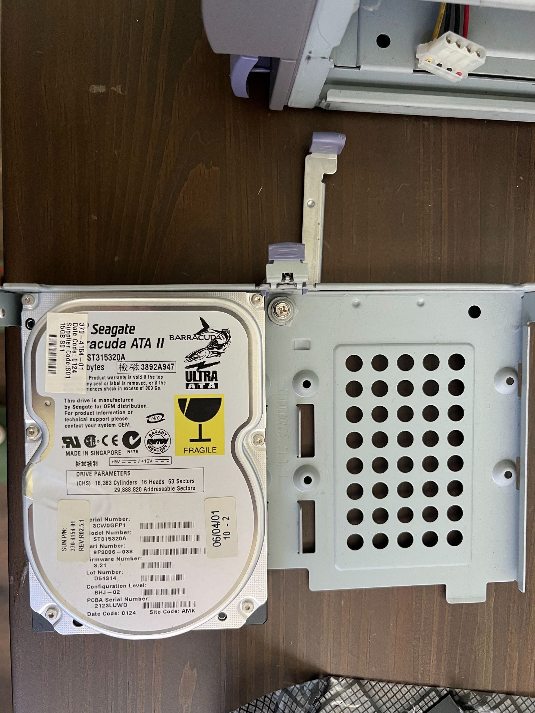

After some research, I decided to use an industrial CompactFlash card with a CF-to-IDE adapter. In True IDE mode, a CF card can appear as a PATA/IDE disk. As far as I know, most industrial CF cards support True IDE mode, whereas consumer CF cards do not necessarily do so. I therefore chose a used Transcend CompactFlash 32GB Industrial CF Card, model CF170. For the adapter, I selected the [StarTech IDE to CompactFlash SSD Card Reader for 3.5in Bay (35BAYCF2IDE)](https://www.amazon.com/dp/B000T9QQP0). This adapter provides ATA-mode jumpers and Master/Slave settings, rather than being a simple passive adapter.

Once I had chosen the upgrade components, the next step was to reconnect the IDE cables. This revealed a problem. The machine has two IDE channels, but originally only the primary channel was used, with the ST315320A hard drive and LTN486S CD-ROM sharing the same cable. The ST315320A was the master and the LTN486S was the slave. For reasons I could not determine, after I replaced the ST315320A with the CF card, OpenBoot detected both IDE devices, but the Solaris 9 installer could not detect either of them.

During further troubleshooting, I found a solution. I kept the CF card as the primary IDE master, but moved the LTN486S CD-ROM to the secondary channel as its master. With this arrangement, both devices were detected, including during the subsequent Solaris 9 installation. The final output of probe-ide is shown below:

```text
ok probe-ide
  Device 0  ( Primary Master ) 
          ATA Model: TS32GCF170                              

  Device 1  ( Primary Slave ) 
         Not Present

  Device 2  ( Secondary Master ) 
         Removable ATAPI Model: LTN486S                                 

  Device 3  ( Secondary Slave ) 
         Not Present
```

## Installing Solaris 9

The Sun Blade 100 is an entry-level Sun workstation from around 2000 and originally shipped with Solaris 8. After some research, I found Solaris 9 to be a good balance: newer than Solaris 8, while still placing a reasonable load on this machine. Although Solaris 10 supports this workstation model, I felt it would be too demanding for a system of this age. I ultimately chose Solaris 9 9/05 GA, the last official Solaris 9 release from Sun.

Another consideration was how to install Solaris 9. Installing from CD-ROM is straightforward but would require burning an ISO image. The other option was a network installation, which interested me most.

The main server in my homelab is a Dell T40 running Fedora 44. To install Solaris 9 over the network from a Linux environment, I first needed to ensure that the Sun Blade 100 and the main server were on the same subnet. The main server would provide the necessary services. My network layout is shown below.

```text
                 +------------------+
                 |   AT&T Router    |
                 +------------------+
                          |
                          |
                 +------------------+
                 |     TP-Link      |
                 |  8-Port Switch   |
                 +------------------+
                    |           |
                    |           |
          +---------+           +---------+
          |                               |
+-------------------+         +-------------------+
|   Sun Blade 100   |         |     Dell T40      |
|     Solaris 9     |         |     Fedora 44     |
|  Install Client   |         |  Install Server   |
+-------------------+         +-------------------+
```

After making the physical connections, I needed to configure the main server to support Solaris network booting and installation. The required services and their functions are listed below.

| Service | Function |
| --- | --- |
| RARP | Maps the Sun Blade 100's MAC address to its IP address. |
| TFTP | Transfers the network bootstrap program (inetboot) to the Sun Blade 100. |
| bootparamd | Provides network boot parameters, including the locations of the root filesystem and installation resources. |
| rpcbind | Registers RPC services and handles service lookups, allowing the client to locate RPC services such as bootparamd. |
| NFS | Serves the root filesystem needed for booting and the Solaris 9 installation files over the network. |

One detail is critical: in my testing, the Solaris 9 network installer required NFS v2 during initialization. Most modern Linux distributions have removed NFS v2 support. After investigating, I found that Rocky Linux 8.x supports NFS v2, so I installed a Rocky Linux 8.10 virtual machine on my Dell T40. This VM is used solely to provide NFS. The following command checks which NFS versions the server supports:

```text
$ sudo cat /proc/fs/nfsd/versions
+2 +3 +4 +4.1 +4.2
```

To enable NFS v2, edit the [nfsd] section of /etc/nfs.conf and enable the following option:

```text
[nfsd]
...
vers2=y
udp=y
...
```

Then restart the NFS service.

I did not use DHCP. The Sun Blade 100 obtains its IP address through RARP. I assigned it the static IP address 192.168.1.110 and the hostname sunblade100.

NFS runs on the Rocky Linux 8.10 VM at 192.168.1.111. RARP, TFTP, and bootparamd run on the Dell T40 main server. RARP and TFTP are available in Fedora's upstream RPM repositories, but bootparamd is not. I eventually found a usable [package built for Fedora 26](https://koji.fedoraproject.org/koji/buildinfo?buildID=860374), which was the newest bootparamd package I could find.

Step 1: Disable the firewall on the NFS server. Since this Rocky Linux 8.10 VM serves only NFS and is used only within my homelab subnet, I disabled its firewall to simplify subsequent administration.

```text
$ sudo systemctl disable --now firewalld
$ sudo systemctl mask firewalld
```

Step 2: Configure NFS to export the contents of the Solaris 9 ISO image. On the Rocky Linux 8.10 VM, the ISO is located at /mnt/iso/sol-9-905hw-ga-sparc-dvd.iso. Mount it with the following commands:

```text
$ sudo mkdir -p /mnt/solaris9
$ sudo mount -o loop,ro /mnt/iso/sol-9-905hw-ga-sparc-dvd.iso /mnt/solaris9
```

After mounting the image, edit /etc/exports to export the NFS share:

```text
$ cat /etc/exports
/mnt/solaris9 192.168.1.110(ro,sync,no_subtree_check,insecure,no_root_squash)
$ sudo exportfs -ra
$ sudo exportfs -v
/mnt/solaris9 	192.168.1.110(sync,wdelay,hide,no_subtree_check,sec=sys,ro,insecure,no_root_squash,no_all_squash)
```

Step 3: Configure the firewall rules on the Dell T40 main server. I added a rule allowing unrestricted access from 192.168.1.110 only.

```text
$ sudo firewall-cmd --zone=FedoraWorkstation --add-rich-rule='rule family="ipv4" source address="192.168.1.110" accept'
```

Step 4: Configure TFTP. TFTP provides the bootstrap file needed for Solaris 9 network booting. The file is located at Solaris_9/Tools/Boot/usr/platform/sun4u/lib/fs/nfs/inetboot in the Solaris 9 installation image. I copied it from the NFS server to /var/lib/tftpboot on the Dell T40 main server. I then created a symbolic link named after the hexadecimal representation of the Sun Blade 100's IP address, 192.168.1.110, pointing to inetboot. Finally, I created /tftpboot as a symbolic link to /var/lib/tftpboot.

```text
$ cd /var/lib/tftpboot
$ sudo ln -sfn inetboot /var/lib/tftpboot/C0A8016E
$ sudo ln -s /var/lib/tftpboot /tftpboot
```

Step 5: Configure RARP, which assigns the Sun Blade 100 its IP address. Create /etc/ethers with the following contents:

```text
$ cat /etc/ethers 
00:03:ba:09:3b:84 sunblade100
```

Then restart the service.

Step 6: Configure bootparamd. This service supplies the Sun Blade 100 with network installation parameters, including the location of the root filesystem. Create /etc/bootparams with the following contents:

```text
$ cat /etc/bootparams 
sunblade100 root=192.168.1.111:/mnt/solaris9/Solaris_9/Tools/Boot install=192.168.1.111:/mnt/solaris9 boottype=:in
```

Then restart the service.

With these steps complete, my homelab was ready to boot Solaris 9 over the network. At the OpenBoot prompt, enter boot net - text to start the network boot:

```text
ok boot net - text   
Boot device: /pci@1f,0/network@c,1  File and args: - text
SunOS Release 5.9 Version Generic_118558-34 64-bit
Copyright 1983-2003 Sun Microsystems, Inc.  All rights reserved.
Use is subject to license terms.
Configuring /dev and /devices
Using RPC Bootparams for network configuration information.
Configured interface eri0
Searching for configuration file(s)...
Search complete.
```

The text argument selects a text-based installation. Seeing the following screen means the installer has started successfully:

```text
Select a Language

   0. English
   1. French
   2. German
   3. Italian
   4. Japanese
   5. Korean
   6. Simplified Chinese
   7. Spanish
   8. Swedish
   9. Traditional Chinese

Please make a choice (0 - 9), or press h or ? for help:
```

The installation process is straightforward, so I will not describe every step. The main point is that I selected Entire Group when choosing the software packages, ensuring a complete Solaris 9 installation. I also created a regular user named ericlee during installation.

After installation, the Sun Blade 100 resets automatically. The following boot output indicates that Solaris 9 was installed successfully:

```text
Rebooting with command: boot                                          
Boot device: disk:a  File and args: 
SunOS Release 5.9 Version Generic_118558-34 64-bit
Copyright 1983-2003 Sun Microsystems, Inc.  All rights reserved.
Use is subject to license terms.
configuring IPv4 interfaces: eri0.
Hostname: sunblade100
The system is coming up.  Please wait.
checking ufs filesystems
/dev/rdsk/c0t0d0s7: is logging.
starting rpc services: rpcbind done.
Setting netmask of eri0 to 255.255.255.0
Setting default IPv4 interface for multicast: add net 224.0/4: gateway sunblade100
syslog service starting.
Oct 26 03:32:59 sunblade100 sendmail[202]: My unqualified host name (sunblade100) unknown; sleeping for retry
Oct 26 03:32:59 sunblade100 sendmail[201]: My unqualified host name (sunblade100) unknown; sleeping for retry
volume management starting.
Oct 26 03:33:01 sunblade100 snmpXdmid: Error in Adding Row for Subscription Table Entry
Oct 26 03:33:01 sunblade100 snmpXdmid: Failed to add filter to SP for Event delivery
Creating new rsa public/private host key pair
Creating new dsa public/private host key pair
The system is ready.

sunblade100 console login: root
Password: 
Oct 26 03:33:18 sunblade100 login: ROOT LOGIN /dev/console
Sun Microsystems Inc.   SunOS 5.9       Generic May 2002

# uname -a
SunOS sunblade100 5.9 Generic_118558-34 sun4u sparc SUNW,Sun-Blade-100
```

## Updating the Firmware

After installing Solaris 9, I could update the firmware. My Sun Blade 100 came with the older firmware version 4.0.45, dated February 8, 2001. The latest version was 4.17.1, dated April 11, 2005, distributed under the official patch identifier [119235-01](https://www.oldsilicon.com/technologies/sun-rom-images/ROMS/119235-01.zip). I found the firmware package on the OldSilicon website.

Step 1: Move the JP2 jumper. On the Sun Blade 100, JP2 controls firmware write protection. The default setting makes the firmware read-only. To update it, move JP2 to pins 2–3, as shown below.

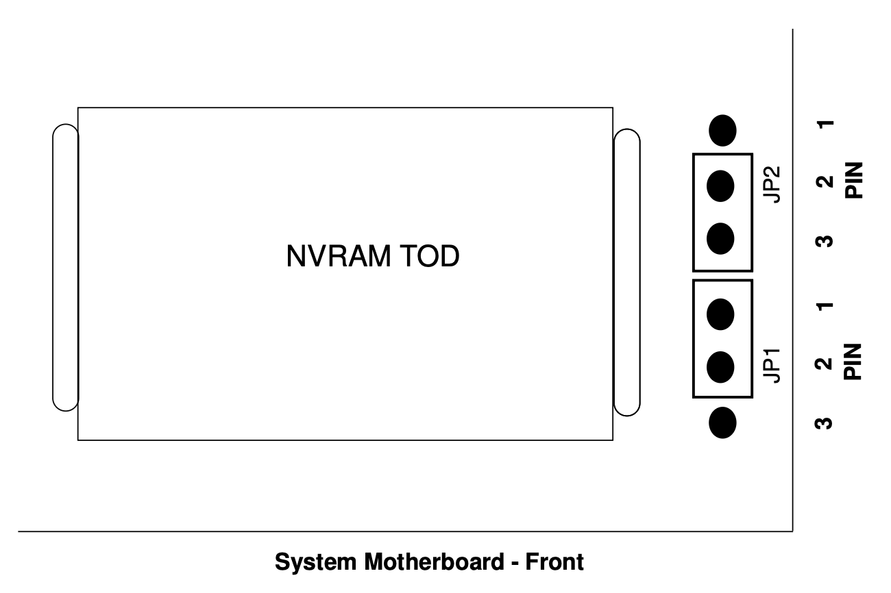

Step 2: Power on the machine and boot Solaris 9. Extract the firmware package, copy flash-update-Blade100-Blade150-latest to the Solaris 9 root directory, set its permissions to 755, and then shut down:

```text
# cp flash*latest  /
# chmod 755 /flash-update*
# halt
```

Step 3: Power on the machine again and enter the OpenBoot prompt. Follow the commands below to update the firmware. Power must not be interrupted during the update. The system resets automatically when the update is complete.

```text
ok boot disk /flash-update-Blade100-Blade150-latest
Boot device: /pci@1f,0/ide@d/disk@0,0  File and args: /flash-update-Blade100-Blade150-latest
/

Standalone Flash PROM Update Utility, Rev. 3.0
			Ultra(tm) 1
			Ultra(tm) 2
			Ultra(tm) 5/10
			Ultra(tm) 30
			Ultra(tm) 60 / E220R / Netra T1120/1125
			Ultra(tm) 80 / E420R / Netra T1400/1405
			Ultra(tm) Enterprise(tm) 250
			Ultra(tm) Enterprise(tm) 450
			Sun Blade(tm) 100
			Sun Blade(tm) 1000
			Sun Blade(tm) 1500
			Sun Blade(tm) 1500 (Silver)
			Sun Blade(tm) 2500
			Sun Blade(tm) 2500 (Silver)
			Sun Fire (tm) 280R
			Sun Fire (tm) 480R / Sun Fire V490
			Sun Fire (tm) 880 / Sun Fire V890
			Netra(tm) T4
			Sun Fire (tm) V210/V240,Netra 240
			Sun Fire (tm) V440, Netra 440


This utility allows you to interactively update the firmware
revisions in specific system Flash PROM components.

Type h for help, q to quit, Return or Enter to continue: 


Every precaution should be taken to prevent the loss of system
power during the Flash PROM programming process!

Type h for help, q to quit, Return or Enter to continue: 


       Firmware Release(s)                Firmware Release(s)
 Currently Existing in the System      Available for Installation  /  Install?
---------------------------------- -------------------------------------------
OBP 4.0.45 2001/02/08 14:33        OBP 4.17.1 2005/04/11 14:31          no
POST 1.2.6 2000/08/30 21:20        POST 2.0.1 2001/08/23 17:13          no

Type sa if you wish to select all available firmware releases for
installation.  Type h for help, quit to exit, or cont to continue: sa


       Firmware Release(s)                Firmware Release(s)
 Currently Existing in the System      Available for Installation  /  Install?
---------------------------------- -------------------------------------------
OBP 4.0.45 2001/02/08 14:33        OBP 4.17.1 2005/04/11 14:31          YES
POST 1.2.6 2000/08/30 21:20        POST 2.0.1 2001/08/23 17:13          YES

Type sa if you wish to select all available firmware releases for
installation.  Type h for help, quit to exit, or cont to continue: cont


The Flash programming process is about to begin.

Type h for help, q to quit, Return or Enter to continue: 


Erasing the top half of the Flash PROM.
Programming OBP into the top half of the Flash PROM.
Verifying OBP in the top half of the Flash PROM.

Erasing the bottom half of the Flash PROM.
Programming OBP into the bottom half of Flash PROM.
Verifying OBP in the bottom half of the Flash PROM.

Erasing the top half of the Flash PROM.
Programming POST into the top half of Flash PROM.
Verifying POST in the top half of the Flash PROM.

Programming was successful.

Resetting ... 

     NOTICE: Initializing security keystore

     NOTICE: Initializing security keystore


Sun Blade 100 (UltraSPARC-IIe), No Keyboard
Copyright 2005 Sun Microsystems, Inc.  All rights reserved.
OpenBoot 4.17.1, 1024 MB memory installed, Serial #50936708.
Ethernet address 0:3:ba:9:3b:84, Host ID: 83093b84.
```

Step 4: Verify the firmware version.

```text
ok .version
Release 4.17.1  created 2005/04/11 14:31
OBP 4.17.1 2005/04/11 14:31
POST 2.0.1 2001/08/23 17:13
OBDIAG 4.17.1 2005/04/11 14:36
```

Step 5: Shut down the machine and return JP2 to pins 1–2.

## Configuring Solaris 9

This was an interesting part of the project. I spent quite a bit of time learning and configuring Solaris 9 so that it could support at least some modern functionality. Below are several configurations I found useful. I may continue updating this section in the future.

### Configuring SSH Access

SSH was the first service I configured. The Solaris 9 SSH service is already running by default:

```text
# ps -ef | grep '[s]shd'
    root   304     1  0 20:43:21 ?        0:00 /usr/lib/ssh/sshd
# netstat -an | grep LISTEN | grep '\.22 '
      *.22                 *.*                0      0 49152      0 LISTEN
      *.22                 *.*                0      0 49152      0 LISTEN
```

However, Solaris 9's SSH implementation is old enough that modern SSH clients cannot log in with their default settings. From the error messages, I identified compatible key-exchange and host-key signature algorithms. My SSH client configuration is shown below:

```text
Host sunblade100 192.168.1.110
    HostName 192.168.1.110
    User ericlee
    KexAlgorithms +diffie-hellman-group-exchange-sha1
    HostKeyAlgorithms +ssh-rsa
```

### Enabling NTP

Although I repaired the NVRAM, its aging RTC may no longer keep accurate time. It is therefore important to give Solaris 9 a reliable time source.

Step 1: Make sure the NTP implementation is installed.

```text
$ ls -l /usr/lib/inet/xntpd
-r-xr-xr-x   1 root     bin       228320 Jun  3  2004 /usr/lib/inet/xntpd
$ ls -l /usr/sbin/ntpq
-r-xr-xr-x   1 root     bin        85076 Apr  6  2002 /usr/sbin/ntpq
```

Step 2: Create /etc/inet/ntp.conf and add the following contents:

```text
server pool.ntp.org
driftfile /var/ntp/ntp.drift
```

Step 3: Start the NTP service.

```text
# /etc/init.d/xntpd stop
# /etc/init.d/xntpd start
```

Step 4: Verify synchronization.

```text
$ /usr/sbin/ntpq -p
     remote           refid      st t when poll reach   delay   offset    disp
==============================================================================
*144.202.66.214  96-19-94-82.cpe  2 u   76  128  377    38.68   -0.413    2.88
```

### Installing OpenCSW Packages

OpenCSW is a community project that provides open-source software packages for Solaris. It is a third-party Solaris software repository containing many useful packages.

Step 1: Install OpenCSW's pkgutil command, which installs and manages OpenCSW software. All OpenCSW packages are installed under /opt/csw.

```text
# wget http://mirror.opencsw.org/opencsw/pkgutil.pkg
# pkgadd -d pkgutil.pkg all
```

Step 2: Update the package index.

```text
# /opt/csw/bin/pkgutil -U
```

Step 3: Add the OpenCSW directories to the command search path. I added the path directly to /etc/profile to make it available system-wide:

```text
PATH=/usr/bin:/usr/sbin:/usr/ccs/bin:/opt/csw/bin:/opt/csw/sbin
export PATH
```

### Installing Other Packages

After setting up OpenCSW, I installed the following additional packages:

```text
curl
gcc4
git
iperf
less
screen
sudo
tcpdump
vim
```

After installation, I added the following settings to /etc/profile so the installed tools would be used:

```text
EDITOR=/opt/csw/bin/vim
VISUAL=/opt/csw/bin/vim
export EDITOR VISUAL

TERM=xterm
PAGER=/opt/csw/bin/less
export TERM PAGER
```

### Changing the User's Shell

Here, I changed the regular user's shell to Bash. The default shell in Solaris 9 is the Bourne shell.

```text
# /usr/sbin/usermod -s /usr/bin/bash ericlee
# getent passwd ericlee
ericlee:x:1000:10::/export/home/ericlee:/bin/bash
```

Then add the following contents to /etc/bashrc:

```text
if [ -n "${BASH_VERSION:-}" ]; then

    # Only apply to interactive shells
    case $- in
        *i*)
            # Linux-style prompt: user@hostname:/full/path$
            PS1='\u@\h:\w\$ '
            export PS1

            # Useful Bash settings
            HISTSIZE=100000
            HISTFILESIZE=20000

            # Append history instead of overwriting it
            shopt -s histappend
            ;;
    esac
fi
```

These settings reflect how I normally work under Linux. Finally, add the following to /etc/profile to load them system-wide:

```text
if [ -n "${BASH_VERSION:-}" ]; then
    case $- in
        *i*)
            if [ -r /etc/bashrc ]; then
                . /etc/bashrc
            fi
            ;;
    esac
fi
```

The Bash settings take effect the next time the user logs in.

## Sun Blade 100 / Solaris 9 Resources

[Solaris 9 Installation Image](https://fsck.technology/software/Sun%20Microsystems/Solaris%20Install%20Media/Sun%20Solaris%209/Sun%20Solaris%209%2009-2005%20%28Update%209%29/)

[GCC SPARC Options](https://gcc.gnu.org/onlinedocs/gcc/SPARC-Options.html)

[OpenCSW Installation Guide](https://www.opencsw.org/manual/for-administrators/setup-old-versions.html)

[Sun Blade 100 Workstation - Full Components List](https://dogemicrosystems.ca/pub/Sun/System_Handbook/Sun_syshbk_V3.4/Systems/SunBlade100/components.html)

[Sun Blade 100 Workstation Documentation](https://docs.oracle.com/cd/E19127-01/blade100.ws/index.html)

[Sun Blade IDPROM Fix](https://www.tal.org/tutorials/sun-blade-100-idprom)

[Frequently Asked Questions about Sun NVRAM/hostid](https://www.sun3arc.org/FAQ/sun-nvram-hostid.faq.phtml)

[STMicroelectronics M48T59 Product Documentation](https://mm.digikey.com/Volume0/opasdata/d220001/medias/docus/1/M48T59%2CY_V.pdf)

[OpenBoot™ 4.x Command Reference Manual](https://docs.oracle.com/cd/E19683-01/816-1177-10/816-1177-10.pdf)
