# Sun Blade 100 工作站修复记录

版本：1.0.0 | 日期：2026-10-31

[English](README.md) | [简体中文](README.zh-CN.md)

在2026年9月，我购买了一台二手的Sun Blade 100工作站。这个文档详细介绍了我是如何修复NVRAM，升级相关的硬件，安装Solaris 9操作系统和升级固件等。在这个文档的最后我列出了我用到的网络资源，供感兴趣的读者参考。

我的所有操作都是通过Sun Blade 100的串口进行操作的。

## 硬件原始状态

下图是硬件的原始状态

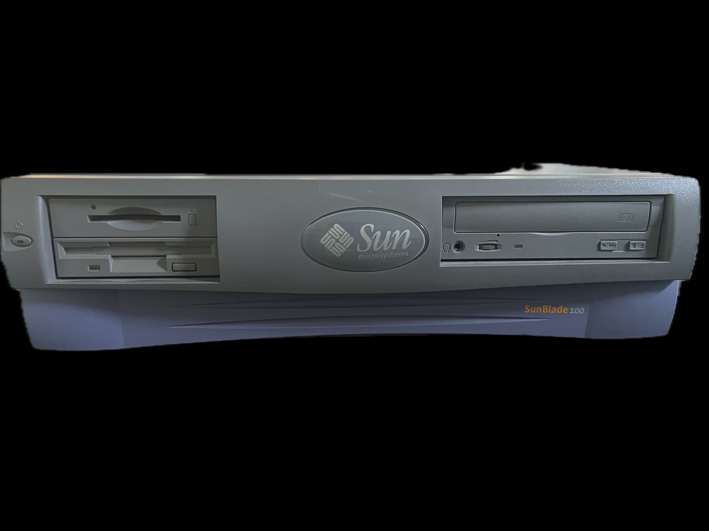

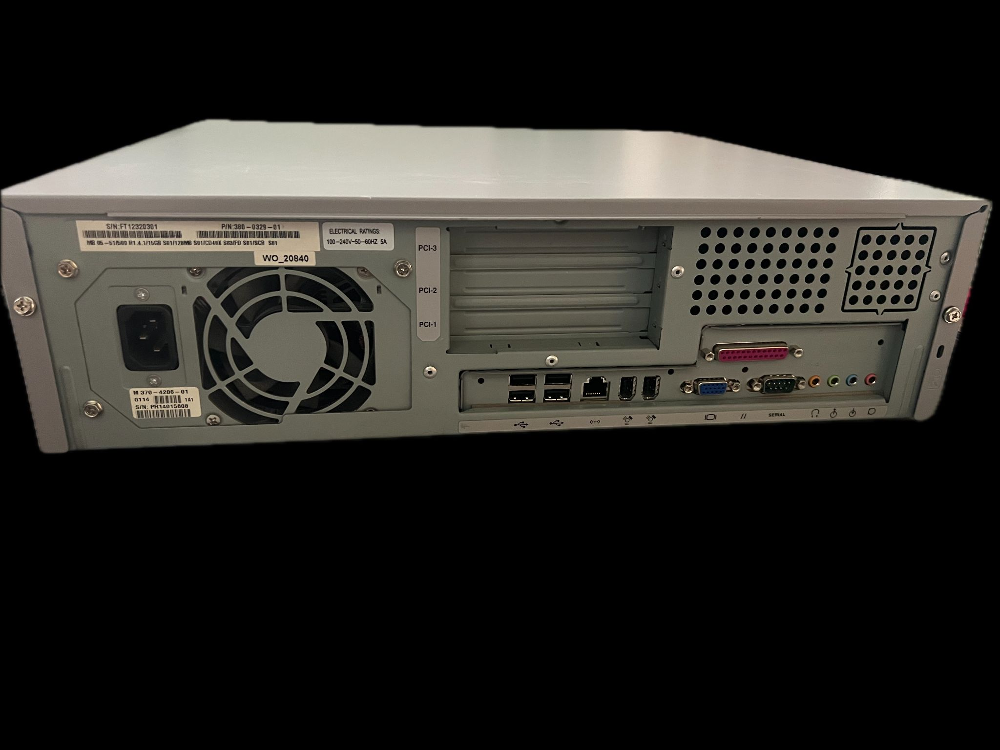

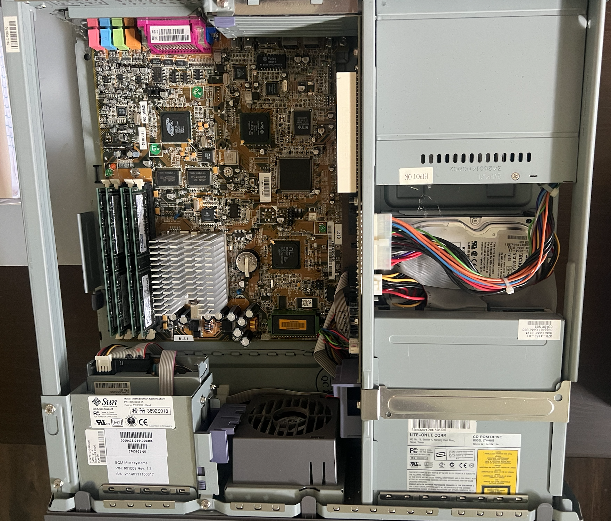

这个是修复前的硬件配置列表

| 组件 | 参数 | 状态 |
| --- | --- | --- |
| CPU | UltraSPARC-IIe 500MHz | 良好 |
| Memory | 1024 MB | 良好 |
| NVRAM | STMicroelectronics M48T59 | 电池已失效 |
| Hard Drive | ST315320A 15.3 GB | 良好 |
| CD-ROM Drive | LTN486S 48X | 良好 |
| Firmware | OBP 4.0.45 2001/02/08 14:33<br>POST 1.2.6 2000/08/30 21:20 |  |
| Operating System | SuSE SPARC Linux version 2.4.14 |  |

## 修复NVRAM

NVRAM是Sun Blade 100上作为保存相关硬件信息，如网卡MAC地址，Host ID和RTC时钟等。NVRAM在Sun的一系列机器上都被使用的十分普遍。NVRAM失效在二手的Sun硬件上十分普遍。大部分原因都是其中的电池已经失效。不幸的是，NVRAM里的电池是已经被封装好的，没有办法进行可拆卸更换。当NVRAM失效时，OpenBoot会提示以下错误：

```text
Sun Blade 100 (UltraSPARC-IIe), No Keyboard
OpenBoot 4.0, 1024 MB memory installed, Serial #32768.
Ethernet address 0:0:0:0:0:80, Host ID: 00008000.


The IDPROM contents are invalid

Power On Self Test Failed.  Cause: NVRAM U13                          
Aborting auto-boot sequence.
ok 
```

在进行任何其他工作之前，必须先修复NVRAM。

修复NVRAM需要两部分。第一部分是恢复电池供电，另一部分是恢复其中的数据。

### 恢复电池

Sun Blade 100使用的NVRAM是STMicroelectronics M48T59型号。在主板上如下图所示

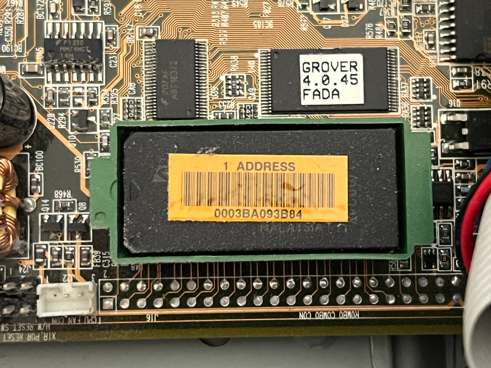

首先要把这个芯片从主板上拔下来。请务必确保垂直方向往上拔出NVRAM，具体的方法是掐住绿色case的两边然后垂直拔出。拔出的芯片如下图所示

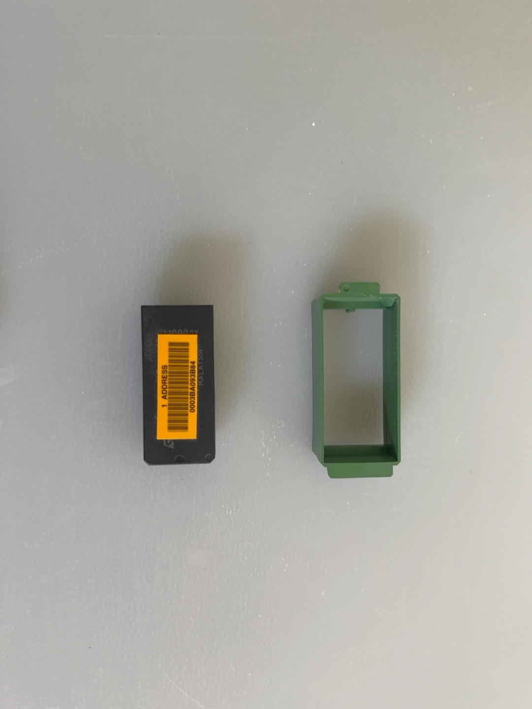

一般NVRAM上会有一个贴纸，标记着这个机器上以太网卡的MAC地址。需要把这个地址记下来，用于稍后的NVRAM数据恢复。

一旦把芯片拔出来，我们就可以开始修复这个NVRAM了。恢复NVRAM电池的基本思路是，把NVRAM进行物理改装，然后连接到一个外接的CR2032纽扣电池。

第一步，首先把芯片翻过来，电池的接点位于芯片上与第 1 引脚相对的那一端，在第 14 和第 15 引脚之间。从芯片底部观察，可以看到两端各有一个填充了灌封胶的小凹槽。电池的连接端子就隐藏在其中一个凹槽内。使用小刀，先切除电池所在一侧的部分塑料外壳，然后开始小心地刮除灌封胶，直到露出内部的电池连接端子。在这个过程中一定要小心，避免伤到内部结构。一旦看到两个电池连接端子暴露出来，就可以停止了。下图是我切开的NVRAM状态

第二步，用万用表确定电池端子的正负极。下图是我的测试结果，很明显，这个原装的NVRAM电池只剩下0.494V的电量了，也同时确定了电池端子的正负极情况

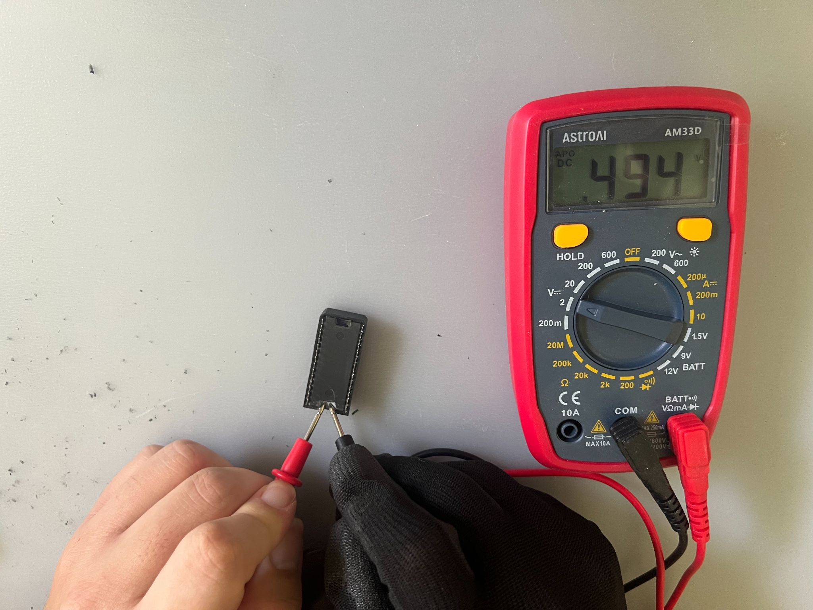

第三步，连接CR2032纽扣电池到已经暴露出的电池端子。我使用了这个[电池盒子](https://www.amazon.com/dp/B0B7MFV6D1)来焊接到NVRAM上。一旦焊接完成，这个NVRAM就可以使用了。在焊接的过程中一定要保证焊接的过程中，焊锡或者电池盒子的导线不能碰触在一起，否则会发生短路。下图是我最后焊接完成的状态

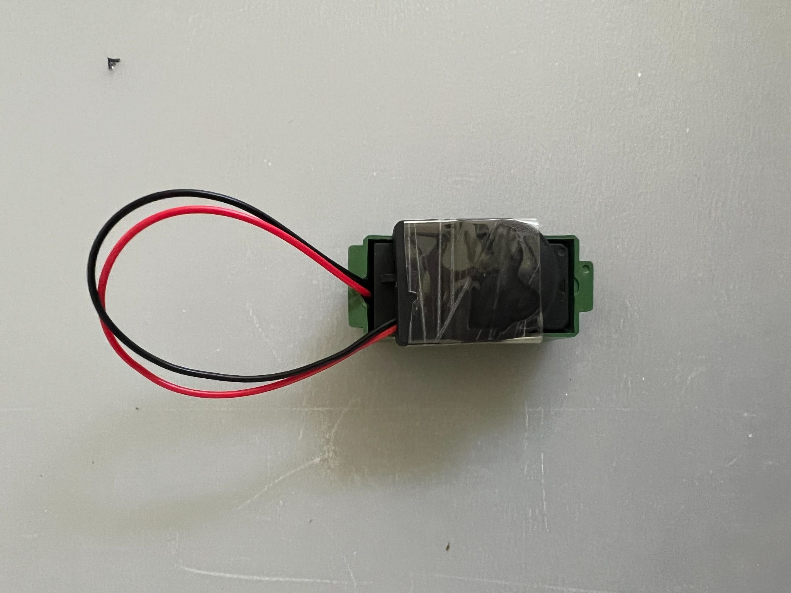

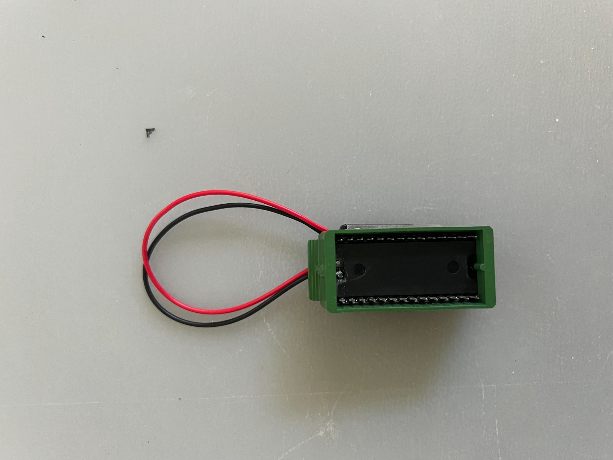

第四步，把修复好的NVRAM插回主板上。下图是我插回NVRAM之后的样子

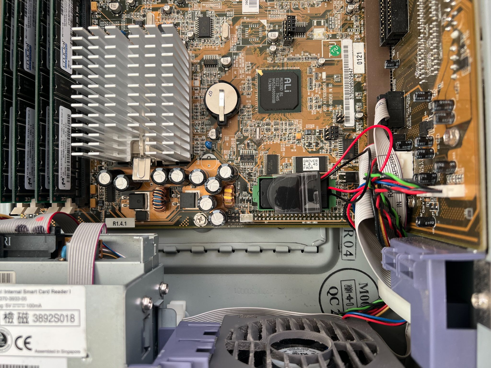

### 恢复IDPROM数据

一旦NVRAM有了新的电池并重新插回主板，就可以开始恢复IDPROM的数据了。首先要恢复的是以太网卡的MAC地址和Host ID。在我的NVRAM上，我已经拿到以太网卡原有的MAC地址了，但是我没有原机器的Host ID。一个常用的方法是根据MAC地址逆向生成一个可用的Host ID。请注意，这个Host ID未必是原有的Host ID，我只是生成一个合理的Host ID保证IDPROM工作即可。

下面这个表格是我要重建的IDPROM的数据储存格式

第一步，我需要检查我要写入IDPROM的地址。在OpenBoot提示符下，运行下面的命令

```text
ok cd /pci@1f,0/ebus@c/eeprom@1,0
ok .properties
model                    mk48t59
address                  fff58000 
reg                      00000001 00000000 00002000 
device_type              nvram
name                     eeprom
```

其中，地址FFF58000是NVRAM的映射基地址，而IDPROM的地址通常在NVRAM偏移0x1FD8。计算方法如下

```text
NVRAM base:     0xFFF58000
IDPROM offset:  0x00001FD8
--------------------------
IDPROM address: 0xFFF59FD8
```

地址0xFFF59FD8就是我需要开始写入的地址。

第二步，保留当前的IDPROM数据。因为这颗NVRAM曾经失效过，因此里面的数据是已经破坏过的。读取这部分数据的目的是检查IDPROM数据里是否还有有用的信息，如果没有，也没有关系。运行以下命令获得IDPROM的字段，其中命令中的10是十六进制的16，我需要读取16字节的数据

```text
ok hex
ok fff59fd8 10 dump
           0  1  2  3  4  5  6  7  \/  9  a  b  c  d  e  f  01234567v9abcdef
fff59fd0  04 88 94 08 08 08 40 00  6a 10 80 00 02 08 00 ac  ......@.j......,
fff59fe0  00 80 20 00 12 a2 14 20  08 80 00 00 04 20 00 8a  .. ..". ..... ..
```

下面是对这些字节的含义

| 字段 | 当前数据 | 判断 |
| --- | --- | --- |
| Format | 6A | 错误，应为 01 |
| Machine Type | 10 | 不符合预期 |
| MAC | 80:00:02:08:00:AC | 与原厂 MAC 不符 |
| Manufacturing Date | 00 80 20 00 | 无法确认 |
| Serial | 12 A2 14 | 不可信 |
| Checksum | 20 | IDPROM 无效 |

通过下面的命令，我可以重新确认IDPROM的数据是否与上面的内容相符

```text
ok .idprom
Format/Type: 6a 10 Ethernet: 80 0 2 8 0 ac Date: 0 80 20 0 
Serial: 12 a2 14 Checksum: 20
```

第三步，重建IDPROM的内容。根据MAC地址，我取用MAC地址的后三个字节作为新的Host ID。下面是我重建的IDPROM数据。请注意，原厂生产日期我无法获得，因此我直接用00000000作为日期，这个字段在实际使用中没有影响。

| 字段 | 新值 | 说明 |
| --- | --- | --- |
| Format | 01 | 标准 IDPROM 格式 |
| Machine Type | 83 | Sun Blade 100 对应的类型值 |
| MAC | 00:03:BA:09:3B:84 | 已确认的原厂地址 |
| Manufacturing Date | 00000000 | 暂用零值，原厂日期未知 |
| Serial | 093B84 | 重建值，不保证为原厂序列号 |
| Checksum | 3B | 前 15 字节的 XOR 校验 |

第四步，写入IDPROM。OpenBoot提供c!命令可以按字节写入。下面是我运行的具体命令

```text
ok hex
ok 01 fff59fd8 c!
ok 83 fff59fd9 c!
ok 00 fff59fda c!
ok 03 fff59fdb c!
ok ba fff59fdc c!
ok 09 fff59fdd c!
ok 3b fff59fde c!
ok 84 fff59fdf c!
ok 00 fff59fe0 c!
ok 00 fff59fe1 c!
ok 00 fff59fe2 c!
ok 00 fff59fe3 c!
ok 09 fff59fe4 c!
ok 3b fff59fe5 c!
ok 84 fff59fe6 c!
ok 3b fff59fe7 c!
ok fff59fd8 10 dump
           0  1  2  3  4  5  6  7  \/  9  a  b  c  d  e  f  01234567v9abcdef
fff59fd0  04 88 94 08 08 08 40 00  01 83 00 03 ba 09 3b 84  ......@.....:.;.
fff59fe0  00 00 00 00 09 3b 84 3b  08 80 00 00 04 20 00 8a  .....;.;..... ..
```

第五步，复位验证。为了使新的IDPROM生效，我需要重新复位机器。下面的命令是我运行复位命令reset-all之后，重新验证的结果

```text
ok banner
Sun Blade 100 (UltraSPARC-IIe), No Keyboard
OpenBoot 4.0, 1024 MB memory installed, Serial #50936708.
Ethernet address 0:3:ba:9:3b:84, Host ID: 83093b84.


ok .idprom
Format/Type: 1 83 Ethernet: 0 3 ba 9 3b 84 Date: 0 0 0 0 
Serial: 9 3b 84 Checksum: 3b 
ok fff59fd8 10 dump
           0  1  2  3  4  5  6  7  \/  9  a  b  c  d  e  f  01234567v9abcdef
fff59fd0  04 88 94 08 08 08 40 00  01 83 00 03 ba 09 3b 84  ......@.....:.;.
fff59fe0  00 00 00 00 09 3b 84 3b  08 80 00 00 04 20 00 8a  .....;.;..... ..
```

可以看到，我的Sun Blade 100已经恢复了有效的IDPROM，而且 OpenBoot 正确识别出了原厂 MAC 地址。

## 升级硬盘

在完成NVRAM的修复之后，我下一步计划更换原有的ST315320A机械硬盘。主要原因有两个。第一，这个硬盘已经有25+年的历史了，可能不够稳定；第二，2000年代左右的机械硬盘噪音都比较大，我想更换成一个更静音的选项。

下图是原机自带的硬盘图片

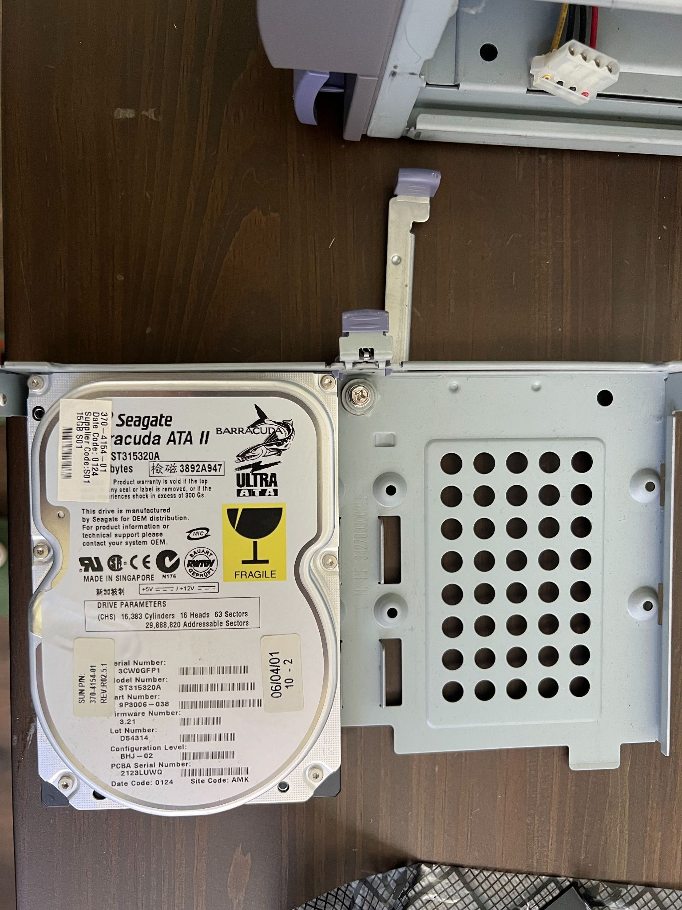

经过一段时间的研究，我决定使用工业CF卡加CF-to-IDE适配器作为解决方案。CF卡可以在True IDE模式下识别成PATA / IDE磁盘。据我所知，大部分的工业CF卡可以在True IDE模式下工作，而消费级CF卡却不能保证这一点。因此我选择了二手的Transcend CompactFlash 32GB Industrial CF Card Model CF170。CF-to-IDE转接卡我选择的是[StarTech IDE to CompactFlash SSD Card Reader for 3.5in Bay (35BAYCF2IDE)](https://www.amazon.com/dp/B000T9QQP0)。这个转接卡提供了ATA模式跳线以及Master / Slave选项，并不是普通的直接转换卡。

一旦确定了升级方案，下一步就是重新连接IDE排线。在这个过程中我发现了一个问题。原有的IDE排线布局是这样的：这个机器一共有两个IDE通道，但是只是用了Primary通道，然后在这个通道里，串联了一个ST315320A机械硬盘和一个LTN486S CD-ROM。其中ST315320A是Master设备，LTN486S是Slave设备。但是基于某些未知的原因，我一旦把CF卡替换ST315320A机械硬盘，OpenBoot虽然能识别出两个IDE设备，但是在后续的Solaris 9安装过程中，任何一个IDE设备都无法被识别出来。

在后续的debug过程中，我找到了一个解决方案。CF卡依然位于IDE Primary通道的Master位置，但是我把LTN486S CD-ROM安装到了Secondary通道的Master位置。在这个条件下，两个IDE设备不仅都能被识别，而且在后面的Solaris 9的安装过程中，两个独立的IDE设备也能被正确地识别出来。下面是最终probe-ide命令的输出

```text
ok probe-ide
  Device 0  ( Primary Master ) 
          ATA Model: TS32GCF170                              

  Device 1  ( Primary Slave ) 
         Not Present

  Device 2  ( Secondary Master ) 
         Removable ATAPI Model: LTN486S                                 

  Device 3  ( Secondary Slave ) 
         Not Present
```

## 安装Solaris 9

Sun Blade 100本身是2000年左右的Sun低端入门级工作站，自带的操作系统是Solaris 8。但是经过我的一些研究，Solaris 9其实是一个很好的平衡选择，比Solaris 8更新，运行起来又不会对这个机器造成太大负担。虽然Solaris 10支持这个型号的工作站，但是对于一台2000年左右的工作站负担还是过大。我最终选择的Solaris 9安装版本是是Solaris 9 9/05 GA版本。这个版本是Sun发布的最后一版官方的Solaris 9操作系统。

另外一个需要考虑的是如何安装Solaris 9操作系统。一种是使用CD-ROM进行安装，这种方法很简单但是需要我刻录ISO镜像；另外一种是进行网络安装，这是我最感兴趣的方法。

我的homelab的主服务器是一台Dell T40服务器，运行Fedora 44。为了能在Linux环境下对Solaris 9进行网络安装，首先我要确保Sun Blade 100和我的主服务器在一个子网，我的主服务器将提供必要的服务。下图是我的网络连接情况

```text
                 +------------------+
                 |   AT&T Router    |
                 +------------------+
                          |
                          |
                 +------------------+
                 |     TP-Link      |
                 |  8-Port Switch   |
                 +------------------+
                    |           |
                    |           |
          +---------+           +---------+
          |                               |
+-------------------+         +-------------------+
|   Sun Blade 100   |         |     Dell T40      |
|     Solaris 9     |         |     Fedora 44     |
|  Install Client   |         |  Install Server   |
+-------------------+         +-------------------+
```

物理连接完成之后，需要对主服务器进行设置，以提供Solaris网络启动及安装的功能。下面是Solaris 9网络安装所需要的服务列表和对应功能

| 服务 | 功能 |
| --- | --- |
| RARP | 根据 Sun Blade 100 的 MAC 地址获取对应的 IP 地址。 |
| TFTP | 向 Sun Blade 100 传输网络引导程序（inetboot）。 |
| bootparamd | 提供网络启动参数，包括根文件系统及安装资源的位置。 |
| rpcbind | 提供 RPC 服务注册与查询功能，帮助客户端定位 bootparamd 等 RPC 服务。 |
| NFS | 通过网络提供启动所需的根文件系统及 Solaris 9 安装文件。 |

这里有一个关键步骤：经过我的测试，Solaris 9的网络安装程序在初始化的时候需要使用NFS v2的协议。而大部分现代Linux发行版早已将NFS v2的支持去掉了。后来经过一些调查，Rocky 8.x是可以支持NFS v2的，因此在我的Dell T40主服务器上我安装了一个Rocky 8.10操作系统的虚拟机。这个虚拟机仅用于提供NFS服务。可以用下面的命令检查NFS服务所支持的版本

```text
$ sudo cat /proc/fs/nfsd/versions
+2 +3 +4 +4.1 +4.2
```

启用NFS v2需要修改/etc/nfs.conf文件中的[nfsd]部分，然后将以下选项启用

```text
[nfsd]
...
vers2=y
udp=y
...
```

再重启NFS服务即可。

另外，我没有使用DHCP服务。Sun Blade 100机器的IP地址分配基于RARP协议。我给Sun Blade 100分配的静态IP地址是192.168.1.110，主机名是sunblade100。

NFS的服务在Rocky 8.10虚拟机上运行，IP地址是192.168.1.111；RARP，TFTP和bootparamd服务则运行在Dell T40主服务器上。其中RARP和TFTP服务都在Fedora的上游RPM软件仓库里，但是和bootparamd却不在。最后，我找到了一个可用的[最终版本](https://koji.fedoraproject.org/koji/buildinfo?buildID=860374)，是一个在Fedora 26上build的一个版本，这是我能找到的最新的bootparamd软件包。

第一步，关闭NFS服务器上面的防火墙。因为这个Rocky 8.10虚拟机仅作为NFS服务并且只在我的homelab子网，因此我关闭了防火墙，便于后面的管理

```text
$ sudo systemctl disable --now firewalld
$ sudo systemctl mask firewalld
```

第二步，配置NFS服务，导出Solaris 9的ISO镜像内容。在Rocky 8.10这个虚拟机上，ISO镜像位置在/mnt/iso/sol-9-905hw-ga-sparc-dvd.iso。然后用以下命令挂载

```text
$ sudo mkdir -p /mnt/solaris9
$ sudo mount -o loop,ro /mnt/iso/sol-9-905hw-ga-sparc-dvd.iso /mnt/solaris9
```

挂载完成后，修改/etc/exports文件，导出NFS共享目录

```text
$ cat /etc/exports
/mnt/solaris9 192.168.1.110(ro,sync,no_subtree_check,insecure,no_root_squash)
$ sudo exportfs -ra
$ sudo exportfs -v
/mnt/solaris9 	192.168.1.110(sync,wdelay,hide,no_subtree_check,sec=sys,ro,insecure,no_root_squash,no_all_squash)
```

第三步，配置Dell T40主服务器上的防火墙规则。这个防火墙规则中，我添加了只允许来自192.168.1.110的访问是没有任何限制的

```text
$ sudo firewall-cmd --zone=FedoraWorkstation --add-rich-rule='rule family="ipv4" source address="192.168.1.110" accept'
```

第四步，配置TFTP服务。TFTP服务提供Solaris 9网络引导所必须的网络引导文件。这个文件位于Solaris 9安装镜像的Solaris_9/Tools/Boot/usr/platform/sun4u/lib/fs/nfs/inetboot位置。我将这个文件从NFS服务器拷贝到Dell T40主服务器的/var/lib/tftpboot目录，然后建立一个Sun Blade 100 IP地址192.168.1.110的16进制软连接，将其指向这个inetboot文件。最后，建立一个/tftpboot的软连接，指向/var/lib/tftpboot目录

```text
$ cd /var/lib/tftpboot
$ sudo ln -sfn inetboot /var/lib/tftpboot/C0A8016E
$ sudo ln -s /var/lib/tftpboot /tftpboot
```

第五步，配置RARP。RARP的功能是给Sun Blade 100分配IP地址。需要生成一个/etc/ethers文件然后填写以下内容

```text
$ cat /etc/ethers 
00:03:ba:09:3b:84 sunblade100
```

然后重启服务即可。

第六步，配置bootparamd服务。这个服务是提供Sun Blade 100网络安装参数和根文件系统的位置等。需要生成一个/etc/bootparams文件然后填写以下内容

```text
$ cat /etc/bootparams 
sunblade100 root=192.168.1.111:/mnt/solaris9/Solaris_9/Tools/Boot install=192.168.1.111:/mnt/solaris9 boottype=:in
```

然后重启服务即可。

以上步骤完成之后，我的homelab环境就可以网络引导Solaris 9了。在OpenBoot的提示符下输入boot net - text开始进行网络引导

```text
ok boot net - text   
Boot device: /pci@1f,0/network@c,1  File and args: - text
SunOS Release 5.9 Version Generic_118558-34 64-bit
Copyright 1983-2003 Sun Microsystems, Inc.  All rights reserved.
Use is subject to license terms.
Configuring /dev and /devices
Using RPC Bootparams for network configuration information.
Configured interface eri0
Searching for configuration file(s)...
Search complete.
```

这个text参数保证我进行的是文本化安装。一旦看到了下面的内容，就意味着成功进入安装程序了

```text
Select a Language

   0. English
   1. French
   2. German
   3. Italian
   4. Japanese
   5. Korean
   6. Simplified Chinese
   7. Spanish
   8. Swedish
   9. Traditional Chinese

Please make a choice (0 - 9), or press h or ? for help:
```

因为安装过程很直接，我就不一一赘述了。唯一需要强调的是，我在选择软件包的过程中，选择了Entire Group。这个可以保证我可以安装整个完整的Solaris 9。另外在安装过程中，我建立了一个叫做ericlee的普通用户。

安装完成后，Sun Blade 100会自动重新复位，看到以下启动界面就意味着Solaris 9安装成功了

```text
Rebooting with command: boot                                          
Boot device: disk:a  File and args: 
SunOS Release 5.9 Version Generic_118558-34 64-bit
Copyright 1983-2003 Sun Microsystems, Inc.  All rights reserved.
Use is subject to license terms.
configuring IPv4 interfaces: eri0.
Hostname: sunblade100
The system is coming up.  Please wait.
checking ufs filesystems
/dev/rdsk/c0t0d0s7: is logging.
starting rpc services: rpcbind done.
Setting netmask of eri0 to 255.255.255.0
Setting default IPv4 interface for multicast: add net 224.0/4: gateway sunblade100
syslog service starting.
Oct 26 03:32:59 sunblade100 sendmail[202]: My unqualified host name (sunblade100) unknown; sleeping for retry
Oct 26 03:32:59 sunblade100 sendmail[201]: My unqualified host name (sunblade100) unknown; sleeping for retry
volume management starting.
Oct 26 03:33:01 sunblade100 snmpXdmid: Error in Adding Row for Subscription Table Entry
Oct 26 03:33:01 sunblade100 snmpXdmid: Failed to add filter to SP for Event delivery
Creating new rsa public/private host key pair
Creating new dsa public/private host key pair
The system is ready.

sunblade100 console login: root
Password: 
Oct 26 03:33:18 sunblade100 login: ROOT LOGIN /dev/console
Sun Microsystems Inc.   SunOS 5.9       Generic May 2002

# uname -a
SunOS sunblade100 5.9 Generic_118558-34 sun4u sparc SUNW,Sun-Blade-100
```

## 升级固件

当Solaris 9安装完成之后，就可以进行固件的升级了。我的这台Sun Blade 100工作站自带的固件版本比较旧，是4.0.45版本，日期是2001年2月8日。而最新的版本是4.17.1，日期是2005年4月11日。官方的固件版本名称是[119235-01](https://www.oldsilicon.com/technologies/sun-rom-images/ROMS/119235-01.zip)。我在OldSilicon网站找到了这个固件版本的下载包。

第一步，修改JP2跳线。在Sun Blade 100机器上，JP2跳线控制着固件的写保护模式。在默认条件下，固件的状态是只读状态。为了进行固件更新，需要将JP2 跳线移至引脚 2–3。如下图所示

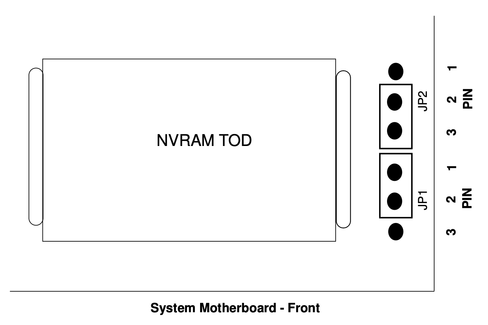

第二步，开机并进入Solaris 9。将固件下载包解包，把文件flash-update-Blade100-Blade150-latest拷贝到Solaris 9的根目录下，并将文件权限设置为755，然后关机

```text
# cp flash*latest  /
# chmod 755 /flash-update*
# halt
```

第三步，重新开机，进入到OpenBoot提示符，依据下面的命令一步步更新固件。在固件升级的过程中，店员绝对不能中断。当固件升级完成之后，系统会自动复位

```text
ok boot disk /flash-update-Blade100-Blade150-latest
Boot device: /pci@1f,0/ide@d/disk@0,0  File and args: /flash-update-Blade100-Blade150-latest
/

Standalone Flash PROM Update Utility, Rev. 3.0
			Ultra(tm) 1
			Ultra(tm) 2
			Ultra(tm) 5/10
			Ultra(tm) 30
			Ultra(tm) 60 / E220R / Netra T1120/1125
			Ultra(tm) 80 / E420R / Netra T1400/1405
			Ultra(tm) Enterprise(tm) 250
			Ultra(tm) Enterprise(tm) 450
			Sun Blade(tm) 100
			Sun Blade(tm) 1000
			Sun Blade(tm) 1500
			Sun Blade(tm) 1500 (Silver)
			Sun Blade(tm) 2500
			Sun Blade(tm) 2500 (Silver)
			Sun Fire (tm) 280R
			Sun Fire (tm) 480R / Sun Fire V490
			Sun Fire (tm) 880 / Sun Fire V890
			Netra(tm) T4
			Sun Fire (tm) V210/V240,Netra 240
			Sun Fire (tm) V440, Netra 440


This utility allows you to interactively update the firmware
revisions in specific system Flash PROM components.

Type h for help, q to quit, Return or Enter to continue: 


Every precaution should be taken to prevent the loss of system
power during the Flash PROM programming process!

Type h for help, q to quit, Return or Enter to continue: 


       Firmware Release(s)                Firmware Release(s)
 Currently Existing in the System      Available for Installation  /  Install?
---------------------------------- -------------------------------------------
OBP 4.0.45 2001/02/08 14:33        OBP 4.17.1 2005/04/11 14:31          no
POST 1.2.6 2000/08/30 21:20        POST 2.0.1 2001/08/23 17:13          no

Type sa if you wish to select all available firmware releases for
installation.  Type h for help, quit to exit, or cont to continue: sa


       Firmware Release(s)                Firmware Release(s)
 Currently Existing in the System      Available for Installation  /  Install?
---------------------------------- -------------------------------------------
OBP 4.0.45 2001/02/08 14:33        OBP 4.17.1 2005/04/11 14:31          YES
POST 1.2.6 2000/08/30 21:20        POST 2.0.1 2001/08/23 17:13          YES

Type sa if you wish to select all available firmware releases for
installation.  Type h for help, quit to exit, or cont to continue: cont


The Flash programming process is about to begin.

Type h for help, q to quit, Return or Enter to continue: 


Erasing the top half of the Flash PROM.
Programming OBP into the top half of the Flash PROM.
Verifying OBP in the top half of the Flash PROM.

Erasing the bottom half of the Flash PROM.
Programming OBP into the bottom half of Flash PROM.
Verifying OBP in the bottom half of the Flash PROM.

Erasing the top half of the Flash PROM.
Programming POST into the top half of Flash PROM.
Verifying POST in the top half of the Flash PROM.

Programming was successful.

Resetting ... 

     NOTICE: Initializing security keystore

     NOTICE: Initializing security keystore


Sun Blade 100 (UltraSPARC-IIe), No Keyboard
Copyright 2005 Sun Microsystems, Inc.  All rights reserved.
OpenBoot 4.17.1, 1024 MB memory installed, Serial #50936708.
Ethernet address 0:3:ba:9:3b:84, Host ID: 83093b84.
```

第四步，验证固件版本

```text
ok .version
Release 4.17.1  created 2005/04/11 14:31
OBP 4.17.1 2005/04/11 14:31
POST 2.0.1 2001/08/23 17:13
OBDIAG 4.17.1 2005/04/11 14:36
```

第五步，关机，然后将JP2跳线恢复至1-2位置

## 配置Solaris 9

这是很有意思的一个部分。我其实用了不少时间学习并配置Solaris 9，让它至少能支持一些现代的功能。下面我包含了一些我觉得比较有用的配置。我在将来也有可能对这一部分进行持续更新。

### 配置SSH访问

这是我第一个首先配置的服务。默认情况下，Solaris 9的SSH服务已经启动了

```text
# ps -ef | grep '[s]shd'
    root   304     1  0 20:43:21 ?        0:00 /usr/lib/ssh/sshd
# netstat -an | grep LISTEN | grep '\.22 '
      *.22                 *.*                0      0 49152      0 LISTEN
      *.22                 *.*                0      0 49152      0 LISTEN
```

但是由于Solaris 9的SSH服务的版本过于久远，现代的SSH客户端并不能直接登陆。通过Solaris 9的SSH错误信息，我找到了可用的密钥交换和主机签名算法，下面是我的SSH客户端配置情况

```text
Host sunblade100 192.168.1.110
    HostName 192.168.1.110
    User ericlee
    KexAlgorithms +diffie-hellman-group-exchange-sha1
    HostKeyAlgorithms +ssh-rsa
```

### 启用NTP

虽然我修复了NVRAM，但是由于NVRAM芯片老旧，其中的RTC时钟有可能不是很准确了，因此保证Solaris 9有可靠的日期服务就十分重要。

第一步，确保NTP实现已经安装

```text
$ ls -l /usr/lib/inet/xntpd
-r-xr-xr-x   1 root     bin       228320 Jun  3  2004 /usr/lib/inet/xntpd
$ ls -l /usr/sbin/ntpq
-r-xr-xr-x   1 root     bin        85076 Apr  6  2002 /usr/sbin/ntpq
```

第二步，创建/etc/inet/ntp.conf文件，并添加以下内容

```text
server pool.ntp.org
driftfile /var/ntp/ntp.drift
```

第三步，启动NTP服务

```text
# /etc/init.d/xntpd stop
# /etc/init.d/xntpd start
```

第四步，验证同步状态

```text
$ /usr/sbin/ntpq -p
     remote           refid      st t when poll reach   delay   offset    disp
==============================================================================
*144.202.66.214  96-19-94-82.cpe  2 u   76  128  377    38.68   -0.413    2.88
```

### 安装OpenCSW软件包

OpenCSW是为Solaris提供开源软件包的社区项目。 它是Solaris上的一个第三方软件仓库。有很多有用的软件包都在这个仓库里。

第一步，安装OpenCSW专有的pkgutil命令。这个命令是OpenCSW用来安装和管理其软件的命令。所有的OpenCSW包都会在/opt/csw这个目录里

```text
# wget http://mirror.opencsw.org/opencsw/pkgutil.pkg
# pkgadd -d pkgutil.pkg all
```

第二步，更新软件包索引

```text
# /opt/csw/bin/pkgutil -U
```

第三步，更新OpenCSW的搜索路径。我把搜索路径直接加到了/etc/profile文件中，保证全局可用

```text
PATH=/usr/bin:/usr/sbin:/usr/ccs/bin:/opt/csw/bin:/opt/csw/sbin
export PATH
```

### 安装其他软件包

当OpenCSW安装完之后，我安装了其他软件包

```text
curl
gcc4
git
iperf
less
screen
sudo
tcpdump
vim
```

安装完后，我添加了以下内容到/etc/profile，保证其中的软件可以被使用到

```text
EDITOR=/opt/csw/bin/vim
VISUAL=/opt/csw/bin/vim
export EDITOR VISUAL

TERM=xterm
PAGER=/opt/csw/bin/less
export TERM PAGER
```

### 修改用户的Shell

这个部分我把普通用户的Shell环境修改为Bash。Solaris 9默认的Shell是Bourne Shell。

```text
# /usr/sbin/usermod -s /usr/bin/bash ericlee
# getent passwd ericlee
ericlee:x:1000:10::/export/home/ericlee:/bin/bash
```

然后在/etc/bashrc这个文件中添加以下内容

```text
if [ -n "${BASH_VERSION:-}" ]; then

    # Only apply to interactive shells
    case $- in
        *i*)
            # Linux-style prompt: user@hostname:/full/path$
            PS1='\u@\h:\w\$ '
            export PS1

            # Useful Bash settings
            HISTSIZE=100000
            HISTFILESIZE=20000

            # Append history instead of overwriting it
            shopt -s histappend
            ;;
    esac
fi
```

这部分我是参考了我在Linux下面的使用习惯。最后，添加以下内容在/etc/profile里，确保全局可用

```text
if [ -n "${BASH_VERSION:-}" ]; then
    case $- in
        *i*)
            if [ -r /etc/bashrc ]; then
                . /etc/bashrc
            fi
            ;;
    esac
fi
```

用户重新登陆就可以应用这个Bash的设置了。

## Sun Blade 100 / Solaris 9相关资源

[Solaris 9安装镜像](https://fsck.technology/software/Sun%20Microsystems/Solaris%20Install%20Media/Sun%20Solaris%209/Sun%20Solaris%209%2009-2005%20%28Update%209%29/)

[GCC SPARC Options](https://gcc.gnu.org/onlinedocs/gcc/SPARC-Options.html)

[OpenCSW安装指南](https://www.opencsw.org/manual/for-administrators/setup-old-versions.html)

[Sun Blade 100 Workstation - Full Components List](https://dogemicrosystems.ca/pub/Sun/System_Handbook/Sun_syshbk_V3.4/Systems/SunBlade100/components.html)

[Sun Blade 100 Workstation Documentation](https://docs.oracle.com/cd/E19127-01/blade100.ws/index.html)

[Sun Blade IDPROM Fix](https://www.tal.org/tutorials/sun-blade-100-idprom)

[Frequently Asked Questions about Sun NVRAM/hostid](https://www.sun3arc.org/FAQ/sun-nvram-hostid.faq.phtml)

[STMicroelectronics M48T59产品文档](https://mm.digikey.com/Volume0/opasdata/d220001/medias/docus/1/M48T59%2CY_V.pdf)

[OpenBoot™ 4.x Command Reference Manual](https://docs.oracle.com/cd/E19683-01/816-1177-10/816-1177-10.pdf)
